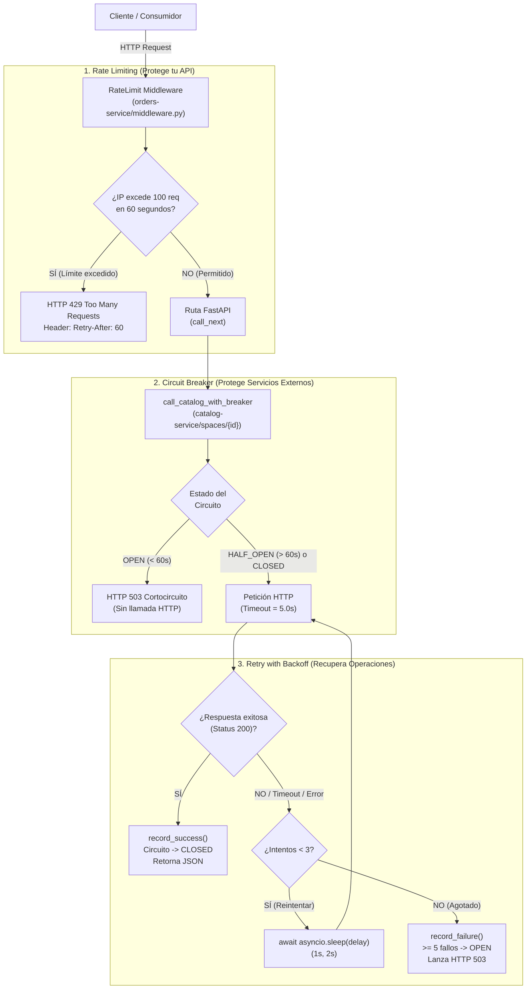

# Taller 5: Resiliencia y Estabilidad en APIs Distribuidas
## LAB 11: Rate Limiting + Circuit Breaker + Retry with Backoff en `orders-service`
**Archivo Principal:** `orders-service/middleware.py`

---

## 🎯 1. Objetivo General

Implementar tres patrones fundamentales de resiliencia y disponibilidad en una API desarrollada con **FastAPI** para proteger el sistema ante sobrecargas, evitar el efecto cascada cuando fallan servicios externos (`catalog-service`), y recuperar automáticamente operaciones que presenten fallos de red transitorios:

1. **Rate Limiting:** Limita a 100 solicitudes por cada 60 segundos por dirección IP mediante una ventana deslizante (*Sliding Window*), respondiendo con HTTP `429 Too Many Requests` y cabecera estándar `Retry-After: 60`.
2. **Circuit Breaker:** Monitorea las llamadas hacia servicios externos dependientes (`catalog-service`). Si se detectan 5 fallos consecutivos, abre el circuito (*OPEN*) para cortocircuitar llamadas de inmediato con HTTP `503 Service Unavailable`, permitiendo tras 60 segundos una prueba de recuperación (*HALF_OPEN*).
3. **Retry with Exponential Backoff:** Reintenta operaciones asíncronas fallidas hasta un máximo de 3 intentos espaciados progresivamente ($1.0s, 2.0s$), propagando la última excepción si todos los intentos fallan.

---

## 🏗️ 2. Arquitectura de Resiliencia y Flujo de Peticiones



---

## 🛡️ 3. Mecanismo 1: Rate Limiter (`RateLimiter`)

### Principio de Funcionamiento
El Rate Limiter almacena un historial de marcas de tiempo (*timestamps*) por cada dirección IP en memoria utilizando un `defaultdict(list)`. Al recibir una solicitud:
1. Depura marcas con antigüedad superior a 60 segundos (`now - t < window_seconds`).
2. Verifica si el número de peticiones válidas restantes es $\ge 100$.
3. Si alcanza el límite, rechaza devolviendo `False`.
4. Si no, añade la marca de tiempo actual y permite con `True`.

```python
class RateLimiter:
    def __init__(self, max_requests: int = 100, window_seconds: int = 60):
        self.max_requests = max_requests
        self.window_seconds = window_seconds
        self.requests = defaultdict(list)

    def is_allowed(self, client_id: str) -> bool:
        now = time.time()
        # 1. Eliminar solicitudes de más de 60 segundos
        self.requests[client_id] = [
            req_time for req_time in self.requests[client_id]
            if now - req_time < self.window_seconds
        ]
        # 2. Bloquear si ya alcanzó las 100
        if len(self.requests[client_id]) >= self.max_requests:
            return False
        # 3. Registrar y permitir
        self.requests[client_id].append(now)
        return True
```

### Middleware FastAPI
Intercepta cada petición entrante antes de que llegue a las rutas de la aplicación:

```python
rate_limiter = RateLimiter(max_requests=100, window_seconds=60)

async def rate_limit_middleware(request: Request, call_next):
    client_ip = request.client.host if request.client else "127.0.0.1"

    if not rate_limiter.is_allowed(client_ip):
        return JSONResponse(
            status_code=429,
            content={"error": "Too many requests"},
            headers={"Retry-After": "60"}
        )

    response = await call_next(request)
    return response

# Registro en FastAPI:
app.middleware("http")(rate_limit_middleware)
```

---

## ⚡ 4. Mecanismo 2: Circuit Breaker (`CircuitBreaker`)

### Máquina de Estados
El Circuit Breaker previene el colapso en cascada de microservicios mediante tres estados:
- **`STATE_CLOSED = "closed"`:** Operación normal. Todas las peticiones van al servicio externo.
- **`STATE_OPEN = "open"`:** Fallas consecutivas alcanzaron el umbral de 5. No se realizan llamadas HTTP; falla rápido con HTTP `503`.
- **`STATE_HALF_OPEN = "half_open"`:** Transcurridos los 60 segundos de recuperación (`recovery_timeout`), se permite una solicitud de prueba. Si es exitosa, se cierra el circuito; si falla, vuelve a `open`.

```python
class CircuitBreaker:
    STATE_CLOSED = "closed"
    STATE_OPEN = "open"
    STATE_HALF_OPEN = "half_open"

    def __init__(self, failure_threshold: int = 5, recovery_timeout: int = 60):
        self.failure_threshold = failure_threshold
        self.recovery_timeout = recovery_timeout
        self.failure_count = 0
        self.last_failure_time = 0
        self.state = self.STATE_CLOSED

    def can_execute(self) -> bool:
        if self.state == self.STATE_CLOSED:
            return True
        if self.state == self.STATE_OPEN:
            if time.time() - self.last_failure_time > self.recovery_timeout:
                self.state = self.STATE_HALF_OPEN
                return True
            return False
        if self.state == self.STATE_HALF_OPEN:
            return True
        return False

    def record_success(self):
        self.failure_count = 0
        self.state = self.STATE_CLOSED

    def record_failure(self):
        self.failure_count += 1
        self.last_failure_time = time.time()
        if self.failure_count >= self.failure_threshold:
            self.state = self.STATE_OPEN
```

### Función de Conexión Protegida al Catálogo
```python
catalog_circuit = CircuitBreaker(failure_threshold=5, recovery_timeout=60)

async def call_catalog_with_breaker(url: str) -> dict:
    if not catalog_circuit.can_execute():
        raise HTTPException(
            status_code=503,
            detail="Catalog service unavailable (Circuit Breaker OPEN)"
        )
    try:
        async with httpx.AsyncClient(timeout=5.0) as client:
            response = await client.get(url)
            if response.status_code == 200:
                catalog_circuit.record_success()
                return response.json()
            elif response.status_code == 404:
                raise HTTPException(status_code=404, detail="Space not found in catalog")
            else:
                catalog_circuit.record_failure()
                raise HTTPException(status_code=503, detail=f"Catalog error: {response.status_code}")
    except Exception as exc:
        catalog_circuit.record_failure()
        raise HTTPException(status_code=503, detail=f"Catalog connection error: {str(exc)}")
```

---

## 🔁 5. Mecanismo 3: Retry with Exponential Backoff

### Principio de Funcionamiento
Aumenta exponencialmente el intervalo de espera entre intentos sucesivos:
- **Intento 1:** Si falla, espera $1.0 \times 2^0 = 1.0\text{ s}$.
- **Intento 2:** Si falla, espera $1.0 \times 2^1 = 2.0\text{ s}$.
- **Intento 3:** Si falla, termina inmediatamente y propaga la última excepción capturada.

```python
async def retry_with_backoff(
    func,
    max_retries: int = 3,
    base_delay: float = 1.0
):
    last_exception = None

    for attempt in range(max_retries):
        try:
            return await func()
        except Exception as e:
            last_exception = e
            if attempt < max_retries - 1:
                delay = base_delay * (2 ** attempt)
                print(f"Retry {attempt + 1}/{max_retries} after {delay}s: {str(e)}")
                await asyncio.sleep(delay)

    raise last_exception
```

---

## 📋 6. Checklist de Implementación (Seguimiento Oficial)

| # | Tarea del Taller | Estado | Detalle |
| :---: | :--- | :---: | :--- |
| **1** | Instalar librerías FastAPI y HTTPX | ✅ Completado | `fastapi==0.162.2`, `httpx==0.25.2` instaladas en el entorno |
| **2** | Crear clase `RateLimiter` | ✅ Completado | En `orders-service/middleware.py` |
| **3** | Configurar 100 solicitudes / 60s por IP | ✅ Completado | `max_requests=100`, `window_seconds=60` |
| **4** | Limpieza de solicitudes antiguas | ✅ Completado | Filtro por comprensión `now - req_time < self.window_seconds` |
| **5** | Crear middleware para cada solicitud | ✅ Completado | `rate_limit_middleware` con HTTP 429 y `Retry-After: 60` |
| **6** | Registrar middleware en FastAPI | ✅ Completado | `app.middleware("http")(rate_limit_middleware)` |
| **7** | Crear clase `CircuitBreaker` | ✅ Completado | En `orders-service/middleware.py` |
| **8** | Configurar estados CLOSED, OPEN, HALF_OPEN | ✅ Completado | Constantes de clase y transiciones de máquina de estados |
| **9** | Límite de 5 fallos y 60s de recuperación | ✅ Completado | `failure_threshold=5`, `recovery_timeout=60` |
| **10** | Crear controlador para `catalog-service` | ✅ Completado | Instancia global `catalog_circuit` |
| **11** | Llamada HTTP con timeout de 5 segundos | ✅ Completado | `httpx.AsyncClient(timeout=5.0)` en `call_catalog_with_breaker` |
| **12** | Crear función `retry_with_backoff` | ✅ Completado | En `orders-service/middleware.py` |
| **13** | Configurar 3 intentos con espera progresiva | ✅ Completado | `max_retries=3`, $1s \to 2s$ exponencial |
| **14** | Integrar funciones en rutas de órdenes | ✅ Completado | Integrado en `POST /orders` de `orders-service/main.py` |
| **15** | Realizar pruebas automatizadas | ✅ Completado | 14 pruebas automáticas superadas (14/14 PASS) |

---

## 🧪 7. Resultados de las Pruebas Automatizadas (`test_taller5_middleware.py`)

Comando de ejecución:
```powershell
python test_taller5_middleware.py
```

Salida de la ejecución:
```text
..............
----------------------------------------------------------------------
Ran 14 tests in 0.175s

OK
 [PASS] 1. RateLimiter permite exactamente las primeras 100 solicitudes de la IP
 [PASS] 2. RateLimiter bloquea exitosamente la solicitud 101 al alcanzar el límite
 [PASS] 3. RateLimiter mantiene registros y contadores aislados por cada dirección IP
 [PASS] 4. RateLimiter depura automáticamente solicitudes fuera de la ventana de 60s
 [PASS] 5. Middleware HTTP permite peticiones dentro del límite y delega a call_next
 [PASS] 6. Middleware HTTP bloquea peticiones excedidas con HTTP 429 y header Retry-After: 60
 [PASS] 7. CircuitBreaker inicializa en estado 'closed' permitiendo peticiones
 [PASS] 8. CircuitBreaker transiciona a 'open' y bloquea llamadas al alcanzar 5 fallos
 [PASS] 9. CircuitBreaker recupera servicio: OPEN -> HALF_OPEN (60s) -> CLOSED
 [PASS] 10. call_catalog_with_breaker cortocircuita y devuelve 503 sin peticiones HTTP
 [PASS] 11. Fallo de red capturado, registra error en CircuitBreaker y responde HTTP 503
 [PASS] 12. retry_with_backoff retorna resultado inmediato en el primer intento exitoso
 [PASS] 13. retry_with_backoff reintenta con backoff exponencial (1s, 2s) y recupera operación
 [PASS] 14. retry_with_backoff propaga la última excepción tras agotar los 3 intentos
```

---

## 💡 8. Observaciones Técnicas y Comparativa Conceptual (Puntos 6 y 7)

### Observaciones para Producción (Punto 6 del documento)
1. **Almacenamiento Distribuido (Redis):** La implementación en memoria (`defaultdict`) es óptima para instancias únicas. En clusters horizontales detrás de un balanceador de carga, el conteo debe delegarse a Redis mediante `INCR` y `EXPIRE` para evitar discrepancias entre réplicas.
2. **Identificación Detrás de Proxies:** `request.client.host` puede reflejar la IP del balanceador (e.g. AWS ALB o Nginx). Se recomienda inspeccionar cabeceras `X-Forwarded-For` validadas por proxies de confianza.
3. **Concurrencia en HALF_OPEN:** En entornos de alto tráfico, es aconsejable usar un cerrojo asíncrono (`asyncio.Lock`) para garantizar que una única petición evalúe la recuperación en `HALF_OPEN`.
4. **Idempotencia en Retries:** No todas las operaciones deben reintentarse. Se deben restringir los reintentos automáticos a métodos idempotentes (como `GET` de catálogo) y nunca reintentar transacciones monetarias o de cobro sin llaves de idempotencia.

### Comparativa de los Tres Mecanismos (Punto 7 del documento)

| Mecanismo | ¿Qué protege? | ¿Para qué sirve? | Impacto en Disponibilidad |
| :--- | :--- | :--- | :--- |
| **Rate Limiter** | Tu propia API / Servidor | Evita saturación y abuso por exceso de solicitudes de una misma IP | Mantiene la API receptiva y previene caídas por sobrecarga |
| **Circuit Breaker** | Servicios externos dependientes | Corta llamadas repetidas hacia dependencias caídas | Evita desperdicio de sockets y latencia en cascada |
| **Retry with Backoff** | Operaciones transitorias | Reintenta con pausas crecientes ($1s, 2s$) | Absorbe intermitencias de red sin degradar al usuario |

