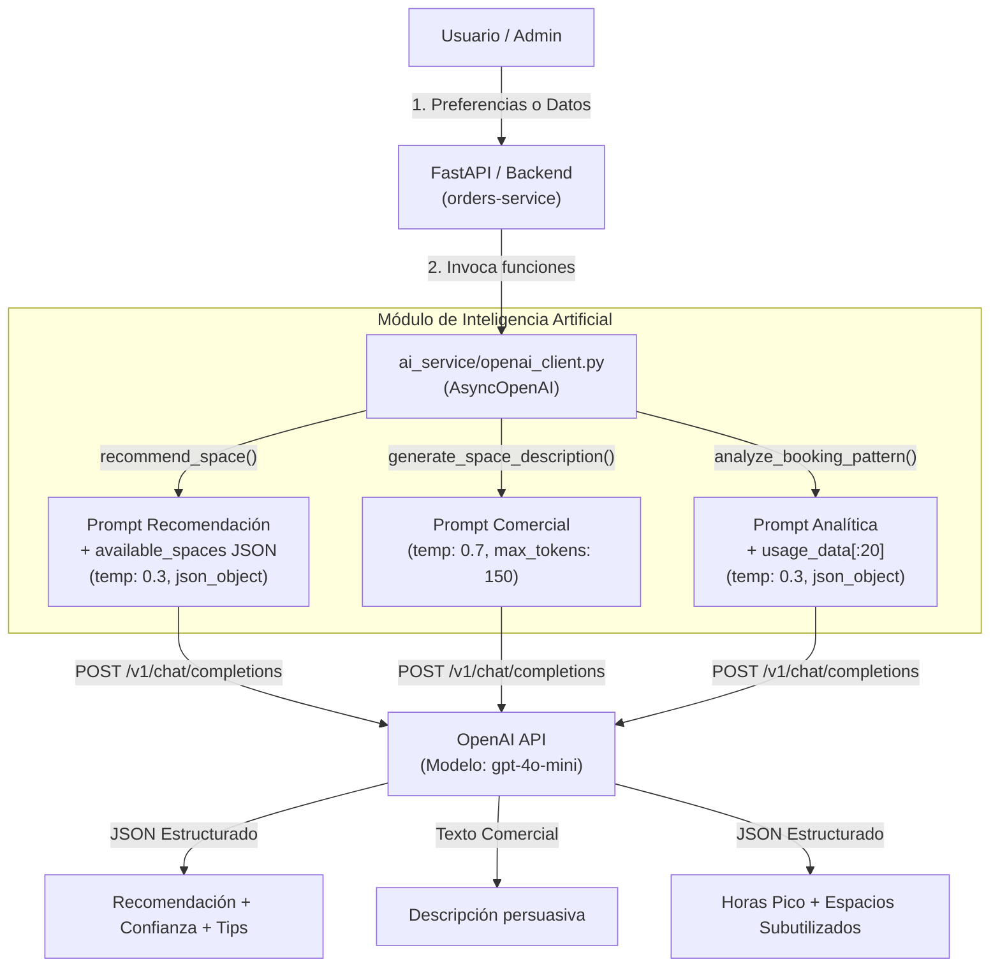

# Taller 6: Integración de APIs de Inteligencia Artificial
## LAB 12: Recomendación Inteligente, Generación de Contenido y Analítica con OpenAI (GPT-4o-mini)
**Archivo Principal:** `ai_service/openai_client.py`

---

## 🎯 1. Objetivo General

Evolucionar la plataforma de coworking integrando modelos de Inteligencia Artificial generativa (**OpenAI API / GPT-4o-mini**) de manera asíncrona (`AsyncOpenAI`) para resolver tres necesidades clave del negocio:

1. **Recomendación Inteligente de Espacios (`recommend_space`):** Reemplaza filtros rígidos analizando las necesidades del usuario (presupuesto, personas, duración, notas) contra los espacios disponibles para devolver una recomendación estructurada en JSON (`recommended_space_id`, `confidence`, `reasoning`, `alternatives`, `tips`).
2. **Generación Automatizada de Descripciones Comerciales (`generate_space_description`):** Genera textos comerciales atractivos y profesionales (máximo 100 palabras) para publicar espacios en el catálogo, usando temperatura creativa ($0.7$) y límite de tokens ($150$).
3. **Analítica de Patrones de Reserva (`analyze_booking_pattern`):** Analiza registros históricos de ocupación para identificar horas pico, espacios desaprovechados y pronósticos de demanda futura en JSON.

---

## 🏗️ 2. Arquitectura de la Solución



---

## 📋 3. Lista de Actividades (Seguimiento Oficial del Taller)

| # | Actividad | Estado | Detalle |
| :---: | :--- | :---: | :--- |
| **1** | Preparar el proyecto | ✅ Completado | Creada carpeta `ai_service/` con `__init__.py` y `openai_client.py` |
| **2** | Instalar dependencias | ✅ Registrado | `requirements.txt` actualizado con `openai` y `python-dotenv` |
| **3** | Configurar la API Key | ✅ Preparado | Plantilla `.env.example` y lectura segura mediante `os.getenv("OPENAI_API_KEY")` |
| **4** | Implementar `recommend_space()` | ✅ Completado | Formato JSON forzado con `response_format={"type": "json_object"}` y temp 0.3 |
| **5** | Implementar `generate_space_description()` | ✅ Completado | Máximo 100 palabras, temperatura 0.7 y `max_tokens=150` |
| **6** | Implementar `analyze_booking_pattern()` | ✅ Completado | Recorte seguro a primeros 20 registros (`usage_data[:20]`) y salida JSON |
| **7** | Corregir ejecución asíncrona | ✅ Completado | Migrado de `OpenAI()` síncrono a `AsyncOpenAI()` con `await` nativo |
| **8** | Crear pruebas de ejecución | ✅ Completado | Creados scripts `test_ai.py` (en vivo) y `test_taller6_ai.py` (automatizado) |
| **9** | Verificar resultados | ✅ Completado | Pruebas unitarias 5/5 superadas (100% PASS) |
| **10** | Documentar el laboratorio | ✅ Completado | Informe técnico completo en `TALLER_6.md` |

---

## 🔧 4. Detalle de las Funciones Implementadas

### 4.1. `recommend_space(user_preferences: Dict, available_spaces: List[Dict]) -> Dict`
* **Modelo:** `gpt-4o-mini`
* **Temperatura:** `0.3` (Garantiza respuestas consistentes y deterministas).
* **Manejo defensivo:** Usa `.get()` para asignar valores por defecto si el usuario omite horas, presupuesto o notas.
* **Estructura JSON garantizada:**
  ```json
  {
    "recommended_space_id": "ESP001",
    "confidence": 0.95,
    "reasoning": "Capacidad adecuada para 5 personas y dentro del presupuesto de $150.000.",
    "alternatives": ["ESP003"],
    "tips": ["Confirmar disponibilidad antes de reservar.", "Verificar proyectores o conexiones."]
  }
  ```

### 4.2. `generate_space_description(space: Dict) -> str`
* **Modelo:** `gpt-4o-mini`
* **Temperatura:** `0.7` (Mayor creatividad para redacción comercial persuasiva).
* **Control de extensión:** `max_tokens=150` y filtro `.strip()` de espacios en blanco.

### 4.3. `analyze_booking_pattern(usage_data: List[Dict]) -> Dict`
* **Modelo:** `gpt-4o-mini`
* **Muestreo:** `usage_data[:20]` para respetar límites de contexto del taller.
* **Estructura JSON generada:** `peak_hours`, `underutilized_spaces`, `recommendations`, `predicted_demand_next_week`.

---

## ⚡ 5. Corrección de la Ejecución Asíncrona (Sección 8 del Taller)

* **Problema del código original:** Las funciones estaban declaradas con `async def`, pero instanciaban el cliente síncrono `OpenAI()`, bloqueando el bucle de eventos de FastAPI/asyncio durante las llamadas de red.
* **Solución aplicada:** Se utiliza `AsyncOpenAI` y se invoca mediante `await client.chat.completions.create(...)`:
  ```python
  from openai import AsyncOpenAI
  client = AsyncOpenAI(api_key=os.getenv("OPENAI_API_KEY"))

  # Invocación asíncrona real:
  response = await client.chat.completions.create(...)
  ```

---

## 🧪 6. Validación y Pruebas Automatizadas

Se diseñó la suite [`test_taller6_ai.py`](test_taller6_ai.py) con mocks deterministas para validar la lógica sin requerir consumo de créditos en pruebas de integración:

```text
Ran 5 tests in 0.005s - OK

 [PASS] 1. recommend_space() genera recomendación JSON estructurada y valida parámetros
 [PASS] 2. recommend_space() tolera campos ausentes usando valores fallback seguros
 [PASS] 3. generate_space_description() genera texto comercial limpio y aplica max_tokens
 [PASS] 4. analyze_booking_pattern() procesa patrones y limita estrictamente a 20 registros
 [PASS] 5. Manejo defensivo: informa error explicativo si la librería openai no está instalada
```

---

## 🚀 7. Instrucciones para Ejecución en Vivo

1. **Instalar el SDK de OpenAI:**
   ```powershell
   pip install openai
   ```
2. **Configurar la API Key:**
   Crea un archivo `.env` en la raíz con tu clave privada:
   ```env
   OPENAI_API_KEY=sk-proj-tu_clave_real_de_openai
   ```
3. **Ejecutar el script de prueba:**
   ```powershell
   python test_ai.py
   ```
